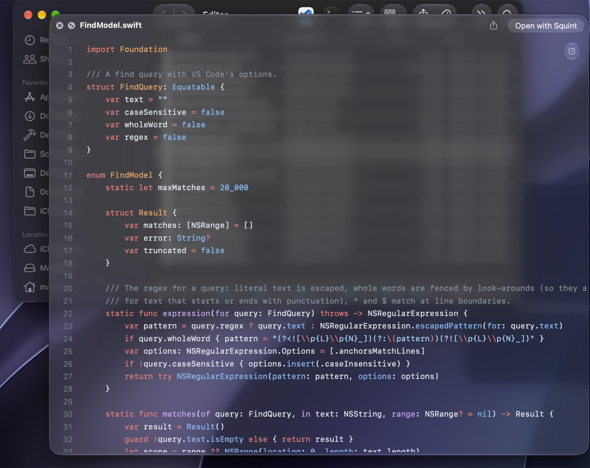
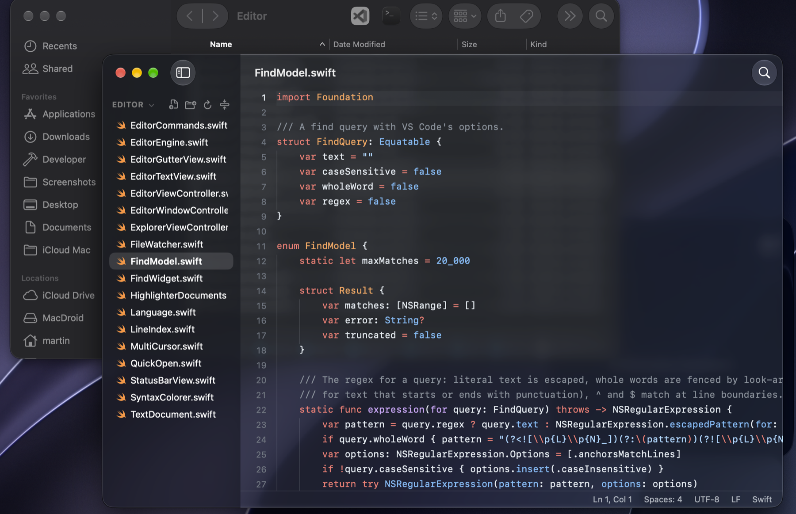

# Squint

A macOS Quick Look extension that previews code with [Shiki](https://shiki.style) (VS Code grammars and themes),
replacing the Syntax Highlight app, plus a lightweight editor for quick code edits. Press Space on any source/config
file (`.c`, `Dockerfile`, `.env`, …); double-click it to edit.

## Screenshots

**Quick Look** – press Space on a file in Finder. The preview is transparent, so it sits on Quick Look's own glass
window and the Finder window behind it shows through:



**Editor** – double-click the file (or hit *Open with Squint* in the preview). Native glass window with the Explorer
sidebar, VS Code-style editing and the status bar:



## Features

- **Quick Look preview** – read-only, native text view with line numbers, transparent so it sits on Quick Look's own
  glass window.
- **Editor** – a small, CotEditor-sized take on VS Code with a native glass window:
  - Explorer sidebar (⌘B toggles it, ⇧⌘E focuses it) with the folder of the opened file: lazy tree, new file / folder,
    inline rename (↩), Move to Trash (⌘⌫), reveal in Finder, copy path, open in Terminal; the root's menu switches to a
    parent folder. It follows changes on disk.
  - No tabs: clicking another file switches the editor; unsaved changes ask Save / Don't Save / Cancel first (also when
    closing the window or quitting). Back / Forward (⌃- / ⌃⇧-) and next / previous file in folder (⇧⌘] / ⇧⌘[).
  - VS Code's find widget (⌘F, replace ⌥⌘F): match case ⌥⌘C, whole word ⌥⌘W, regex ⌥⌘R (with `$1` replacements),
    preserve case ⌥⌘P, find in selection ⌥⌘L, ⌘G / ⇧⌘G, ⌥↩ selects every match.
  - Go to File ⌘P (fuzzy, skips `node_modules` and `.gitignore`d files; `:42` goes to a line), Go to Line ⌃G.
  - VS Code editing: toggle comment ⌘/ and ⇧⌥A, move lines ⌥↑/⌥↓, copy lines ⇧⌥↑/⇧⌥↓, delete line ⇧⌘K, ⌘↩ / ⇧⌘↩,
    ⌘L, ⌘] / ⌘[, ⌃J, jump to bracket ⇧⌘\, multiple cursors (⌘D, ⇧⌘L, ⌥⌘↑/↓, ⇧⌥I, ⌥-click), copy / cut a whole line
    with no selection, auto-closing brackets and quotes, auto-indent, smart Home, tab stops, word wrap ⌥Z, zoom ⌘= / ⌘-.
  - Status bar: position, indentation (detected per file; convert spaces ⇄ tabs), encoding (kept on save, incl. BOM,
    UTF-16, Windows-1250), line endings (kept; switchable) and language (any Shiki grammar).
  - Saving writes in place, so permissions, symlinks and hard links survive; files changed by other apps reload when
    unchanged here, and saving over a newer version asks first.
- **Settings** (⌘,) – themes, font, editor options, glass window, the Quick Look background, and which apps still open
  file types Squint could open. Stored in `~/.config/squint/config.json`.

## Install

Download `Squint-<version>.dmg` from [Releases](https://github.com/mortynex/squint/releases), open it and drag Squint
to Applications. Squint isn't notarized yet, so the first launch is blocked: open System Settings › Privacy & Security
and click **Open Anyway** (or run `xattr -dr com.apple.quarantine /Applications/Squint.app`). Launching it once
registers the Quick Look extension.

**Updates** – Squint checks GitHub once a day (Settings › Updates, or Squint › Check for Updates…). *Install and
Relaunch* downloads the new version, checks its signature, swaps it in when Squint quits and starts it again.

## Default app

The app's Info.plist claims every type the preview handles (and the code types other editors claim), so Squint opens
them unless another app was chosen for them. Taking a type from another app is up to you: macOS asks to confirm each
type, so Settings › Default App lists the other apps with a **Use Squint** button each, and only the types files
actually resolve to. TeX files are claimed as Alternate, so a TeX app keeps them. Extensionless files (`public.data`)
can't be reassigned programmatically.

## Build

```sh
(cd js && npm install && ./build.sh)   # bundles Shiki: Resources/core.js, langs/, themes/, themes.json, langs.json
python3 tools/gen-utis.py              # regenerates the declared content types (Extension/ and App/ Info.plist)
swift tools/make-icon.swift            # regenerates App/AppIcon.icns
./build.sh                             # build/Squint.app (ad-hoc signed)
./install.sh                           # copies to /Applications and registers the extension
test/editor.sh                         # headless editor tests (see below)
```

`vendor/` holds a static arm64 Oniguruma (`brew install oniguruma`); regexes run natively through `Shared/onigshim.c`
instead of Shiki's slower JS regex engine. `test/snap.sh` renders the preview offscreen to a PNG for visual checks.

`test/editor.sh` builds the editor's sources into a test runner: tokenizer (incremental re-highlighting must equal a
fresh pass after random edits, and match Quick Look's colours), editing commands, multiple cursors, find / replace,
file formats, the unsaved-changes flow, the Explorer, Go to File and the menu shortcuts. `test/editor.sh --showcase
<find|quickopen|multicursor|nosidebar|light|settings>` opens real windows for screenshots instead.

## Releasing

1. Bump `VERSION` (e.g. `1.1.0`) and commit.
2. `./release.sh --publish` builds `build/release/Squint-<version>.dmg`, `.zip` and `.zip.sig`, tags `v<version>`,
   pushes the tag and creates the GitHub release (notes from `RELEASE_NOTES`, else generated). Without `--publish`
   it only builds the files.

The zip is signed with an Ed25519 key kept in the login Keychain as "Squint Update Key" (`swift tools/update-key.swift
generate` made it; its public half is `SquintUpdatePublicKey` in `App/Info.plist`). Back it up: without it, installed
copies can't verify new releases. `SQUINT_UPDATE_KEY` (base64) can supply it instead, e.g. in CI. To test the updater
against a local release, run the app binary with `SQUINT_UPDATE_FEED=file:///path/to/latest.json` (GitHub's release
JSON shape, with `file:` asset URLs).

With a Developer ID certificate, `SIGN_IDENTITY="Developer ID Application: …"` signs with the hardened runtime, and
`NOTARY_PROFILE=<notarytool keychain profile>` also notarizes and staples the app and DMG (untested so far).

## Notes

- Disable/remove the Syntax Highlight app so the two extensions don't compete.
- The extension's sandbox has one temporary exception: read-only access to `~/.config/squint/`.
- The extension and the app both have `com.apple.security.cs.allow-jit`: without it JavaScriptCore only interprets,
  which makes grammar setup about 3× slower.
- The extension keeps one highlighter for the life of its process, so later previews reuse the JS engine and, for
  languages seen before, the loaded grammar and compiled regexes. It starts over after 8 languages to bound memory.
- The editor tokenizes line by line, keeping each line's grammar state (`shikiDoc*` in `js/entry.js`): an edit is
  re-tokenized from its line until the state matches the old one, in a few milliseconds; the rest of a long file is
  coloured in 12 ms slices. Colours are layout-manager temporary attributes, which keep typing fast in big files.
- `.ts` is claimed for TypeScript, so real MPEG-2 `.ts` videos no longer preview as video.
